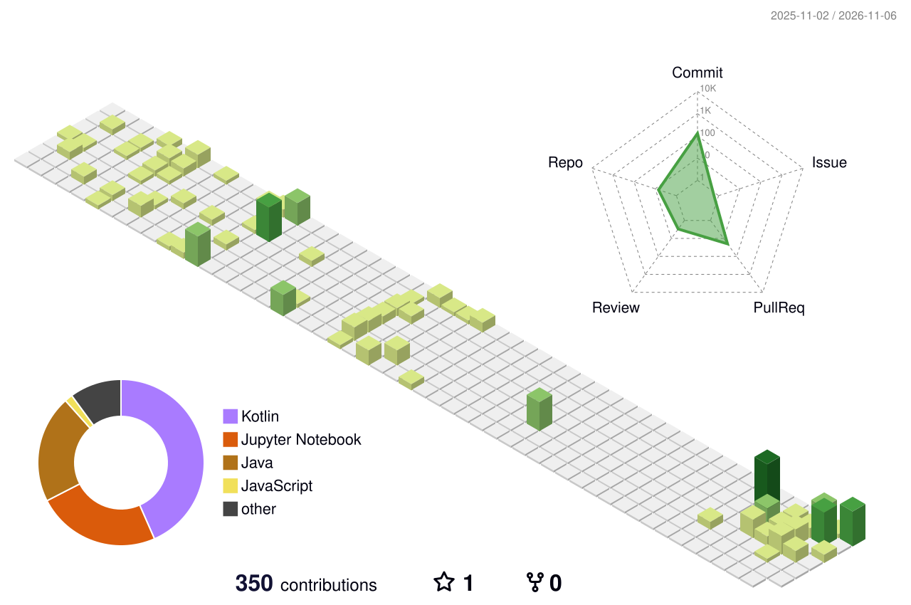

  

  
  
  

  

### About me

German University in Cairo, Computer Science and Engineering. My bachelor thesis looked at using decoder-based LLMs (Mistral, LLaMA, Gemma, DeepSeek) for cybersecurity tasks like phishing detection and threat intel extraction.

Most of what I build sits somewhere between backend/data systems and applied ML: Android apps, a database engine written from scratch, and a few projects combining knowledge graphs and LLMs.

### Tech I work with

  

### Some projects

| Project | What it is |
|---|---|
| [Large-Language-Models-for-Cybersecurity](https://github.com/MohamedElquesni/Large-Language-Models-for-Cybersecurity) | My bachelor thesis, fine-tuning decoder LLMs for SOC-style tasks |
| [16-galacticos-EventTicketing](https://github.com/Mohamed-Marzaban/16-galacticos-EventTicketing) | Microservices event ticketing platform (Spring Boot, JWT auth, RabbitMQ, per-service databases), built with a 15-person team; I worked on booking-service |
| [Database-Management-System-DBMS](https://github.com/MohamedElquesni/Database-Management-System-DBMS) | A relational database engine in Java, B+ tree indexing, serialized pages |
| [ACL-International-Hotel-Booking-Analytics](https://github.com/MohamedElquesni/ACL-International-Hotel-Booking-Analytics) | Hotel recommendation assistant combining a Neo4j knowledge graph with RAG and GPT-4 |
| [Android-Weather-App](https://github.com/MohamedElquesni/Android-Weather-App) | Weather app in Jetpack Compose with GPS, dark mode, and Arabic RTL support |
| [Android-Meal-App](https://github.com/MohamedElquesni/Android-Meal-App) | Recipe browser on TheMealDB API, MVVM with Navigation Component |

### Contributions

<picture>
  <source media="(prefers-color-scheme: dark)" srcset="./profile-3d-contrib/profile-night-rainbow.svg" />
  <source media="(prefers-color-scheme: light)" srcset="./profile-3d-contrib/profile-green-animate.svg" />
  
</picture>

<picture>
  <source media="(prefers-color-scheme: dark)" srcset="https://raw.githubusercontent.com/MohamedElquesni/MohamedElquesni/output/github-snake-dark.svg" />
  <source media="(prefers-color-scheme: light)" srcset="https://raw.githubusercontent.com/MohamedElquesni/MohamedElquesni/output/github-snake.svg" />
  
</picture>

